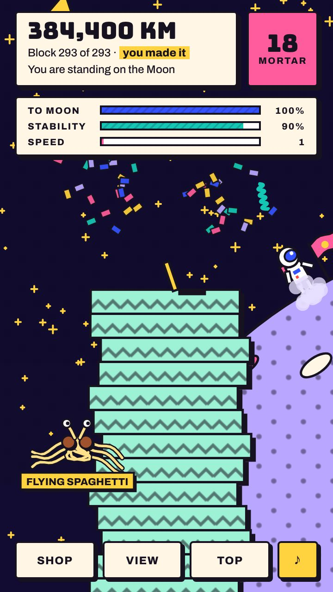
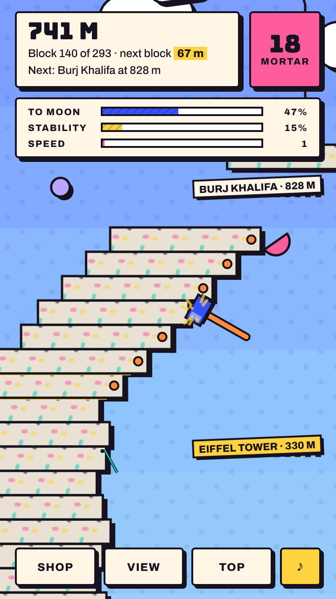
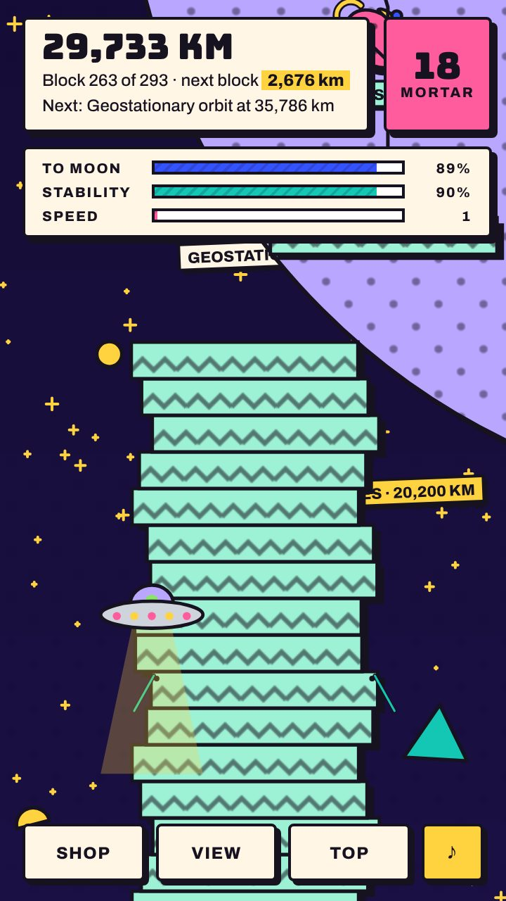

# Tower to the Moon

Stack blocks from 1 mm to the Moon (384,400 km). Blocks never fall: a crooked tower bends, and you hammer it straight to the beat.

**[Website](https://kubratemtehh-jpg.github.io/tower-to-the-moon-download/)** · **[Download for Android](https://github.com/kubratemtehh-jpg/tower-to-the-moon-download/releases/latest/download/tower-to-the-moon.apk)** · **[Play in your browser](https://kubratemtehh-jpg.github.io/tower-to-the-moon-download/play/)**

  

## Install
1. Tap **Download for Android** on your phone.
2. Open the downloaded file and allow installs from your browser when asked.
3. If Play Protect asks, tap **Install anyway**.

Updates are offered inside the game (Shop → Game version).

[Privacy policy](privacy.html)
